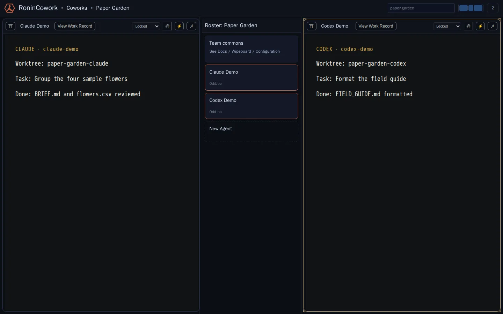

# Ronin

Ronin is not another IDE for your Agents. It is a lightweight, locally run coworkspace
around the Agents, accounts, tools, and documents you already use.

Claude and Codex can run side by side, each in its own worktree. Ronin gives their live
terminal sessions one browser surface on a machine you control; you choose how independently
or closely they work through the behaviours you give them.

If Ronin looks cool to you, [give us a star](https://github.com/ronincowork/ronin-cowork)—it
helps other people find it.

## Work side by side

<a href="https://ronincowork.com/explainers/workbench/">
  <picture>
    <source media="(max-width: 600px)" srcset="docs/assets/readme/workbench/workbench-narrow.webp">
    
  </picture>
</a>

[See how two independent Agent providers work side by side in the Workbench.](https://ronincowork.com/explainers/workbench/)

## Coordination without control. A coworkspace without lock-in.

**Your Agents. Your tools. Your working method.**

Ronin is a lightweight coworkspace, not an Agent harness or prompt engine. It does not
sit between you and your model providers, store your work in a proprietary format, or
prescribe how an Agent should behave. It adds optional coordination around the tools and
files you already use.

| Promise | What it means |
|---|---|
| **[Your work stays yours](https://ronincowork.com/explainers/no-platform-lock-in/)** | Your code and documents stay on your machine, in ordinary repositories and files. Ronin does not become a data intermediary or proprietary home for them—so there is no platform lock-in. |
| **[No behavioral takeover](https://ronincowork.com/explainers/no-behavioral-takeover/)** | Ronin gives Agents convenient tools at the edges of cooperation. It does not become their prompt engine or prescribe how they reason, code, or complete their work. |
| **[Editable coordination](https://ronincowork.com/explainers/editable-coordination/)** | Select and customize the reading, Behaviors, capability tools, and connections offered to new Agents. Owner versions live outside the repositories Ronin updates. |

Ronin does not relay your Agent traffic or upload your code and conversations to a Ronin
cloud. Your provider CLI still communicates directly with its model provider, whose data
terms and zero-data-retention options remain the ones that govern that traffic. If you
separately opt into Ronin Services, you may share anonymous operating measurements—never
your code or conversations. Declining sends nothing.

## Coordinate when useful

Agents can remain independent or use optional Team coordination. Direct messages, the team
wipeboard, shared documents, and selected behaviours support closer work without turning a
working convention into an access-control boundary.

```text
independent Agent ── choose what helps ── Team coordination
                         │
                 messages · wipeboard · shared work
```

[See how optional Agent coordination works.](https://ronincowork.com/explainers/agent-coordination/)

## Choose how much coordination you want

| Choice | What it adds |
|---|---|
| **Terminal** | A shell in an always-on tmux terminal. Nothing from Ronin. |
| **Bare-metal Agent** | Claude, Codex, or another provider CLI in an always-on tmux terminal. No Ronin reading list, work record, or receipt. |
| **Cowork Agent** | The same CLI born through Ronin: a work record, documents, capability tools, messaging, and session coordination; in a repository declared for Worktrees, a private branch and worktree with hand-in and the Team lead's promotion, so parallel Agents avoid file collisions ([how it decides](docs/architecture/worktrees.md)). |
| **Installations** | What is on the machine, switched on or off in System settings. Ronin Services joins every Cowork Agent when it is on; Trello and Perplexity make behaviours a Team or Agent can add ([installations and behaviours](docs/architecture/installations.md)). |

[See how session types, installations and behaviours fit together.](https://ronincowork.com/explainers/cowork-and-services/)

## Start with your question

| I want to… | Start here |
|---|---|
| understand the shell, network, and data boundaries | [How Ronin protects your machine and work](docs/getting-started/how-ronin-protects-you.md) |
| decide whether I need another machine | [Choose or rent a machine](docs/getting-started/rent-a-machine.md) |
| have an Agent install Ronin | [Agent-led installation](docs/getting-started/install.md) |
| finish first use in Ronin Setup and start one working Agent | [Get started](docs/getting-started/get-started.md) |
| sign in an Agent provider safely | [Provider sign-in](docs/getting-started/harness-sign-in.md) |
| find use, troubleshooting, or contributor guidance | [Documentation by question](docs/README.md) |

## The two repos

| Repo | What it is | Ships as |
|---|---|---|
| **ronin-cowork** (this one) | the open package — sessions, tiles, Workbench, rosters, notes, wipeboards, capability tools, the commons, launch, and **all frontend** | open repo; versioned releases |
| **ronin-services** | the optional paid layer — additional features installed beside the open `ronin-cowork` package | hosted, versioned archive |

**The open package runs completely alone.** It compiles, boots, and serves a machine's tmux
sessions with no Services present—that is not a degraded mode. A Service adds its feature
when installed; its absence is never an error. If that feature gives an Agent new tools,
those tools are taught through a separate Agent capability document.

## Understand or contribute to Ronin

The [seven-surface contributor map](docs/contributor-map.md) connects visible behavior to
code, state, Services, and tests. Start there to understand the implementation; use
[CONTRIBUTING](CONTRIBUTING.md) when proposing a change.

Services runs inside Cowork through the [connector contract](https://github.com/ronincowork/ronin-services/blob/dev/connector-contract.md).
The [documentation index](docs/README.md) separates usage guides from construction
references. The creators keep proposals, buildouts, and audits in their Ronin Lab;
those documents are not prerequisites for installing or using Ronin.

## Installing it

On a machine you control — your laptop, a home server, or a VM you rent. **No machine
yet?** [`docs/getting-started/rent-a-machine.md`](docs/getting-started/rent-a-machine.md) walks an agent through renting
one: what capacity Ronin needs, and why you want it physically near you. **Want to check
this before you run it?** [How Ronin protects your machine and work](docs/getting-started/how-ronin-protects-you.md)
is written for the Agent you ask to assess it—it names evidence rather than asking for trust.

Two doors, same Ronin; pick one:

**Door 1 — the one command.** For a person with a terminal and nothing else: the
release bundles its own Node, tmux, and node_modules, so this works on a box with
no separate Node or tmux installation. Sign in to Tailscale first; the installer
explains any administrator changes and asks for approval once
(`docs/development/DEPENDENCY_BUNDLE_INSTALL.md`):

```bash
curl -fsSL https://raw.githubusercontent.com/ronincowork/ronin-cowork/master/scripts/get-ronin | sh
```

On Windows: run `wsl --install` once in PowerShell, then run that same command
inside the WSL shell.

**Door 2 — the git path.** For an agent, or anyone who wants to read what they run.
Hand your agent this repository's URL; `docs/getting-started/install.md` is its walk. From a
checkout it can install the bundled release, or a plain one and bring its own tmux
and Node:

```bash
git clone https://github.com/ronincowork/ronin-cowork.git
cd ronin-cowork
bin/ronin-update --home ~/ronin      # fetches the release, verifies, unpacks
cd ~/ronin/current && ./setup.sh     # sets everything up on this machine
```

Setup prints one verified address: `https://<machine>.<tailnet>.ts.net:4810`.
Access is controlled by Tailscale. Connect the browser device to the intended tailnet;
its access rules determine who can use Ronin and the account's shell. Never expose
Ronin to the public internet.

On a local Linux desktop, setup also opens the browser. Follow the printed next step
into Ronin Setup. [Get started](docs/getting-started/get-started.md) continues through
one provider and one harmless successful Agent exchange. An installed Agent CLI is
not proof that its provider is authenticated. If HTTPS cannot be established, resolve
the reported setup problem before continuing.

Already have an Agent on that machine (Claude Code or Codex)? Hand it `docs/getting-started/install.md`;
the Agent stays through first-use proof. Using an Agent is optional, not a requirement.

## Finding work in the coworkspace

Campaign, Cowork, and Team use one Workbench format. [`docs/using-ronin/workbench.md`](docs/using-ronin/workbench.md)
is the third-party Agent's guide to its discovery column, workspaces, surfaces, placement,
and recall. It explains how to find and arrange work without requiring frontend or design
system knowledge.

## Running it (contributors, from a checkout)

Before proposing a change, read [`CONTRIBUTING.md`](CONTRIBUTING.md). Contributions begin
with an issue, use a linked PR into `dev`, and pass the repository and BYOIN checks before
maintainer integration.

```bash
./setup.sh     # installs deps, the tmux server unit, the cowork unit; the service
               # checks its own rendered page on every start
```

Requires a Unix-like host (Linux, macOS, WSL) with tmux; the browser client is any OS.
Ronin joins the default tmux server, beside whatever sessions already live there; when no
server exists, Ronin starts one in its own unit. Restarting or replacing Ronin never touches
running work. `npm run byoin` runs the user-customization check and gives one
verdict; `bin/ronin-uninstall` reverses the install and leaves your own files behind.

## License

The open `ronin-cowork` package is **Apache-2.0** (see `LICENSE` and `NOTICE`)—use it,
fork it, ship it, commercially or not, with Apache's patent grant behind it. **Services are
licensed differently**: source-available, free to download and use, but not to
redistribute or commercialize—each Services archive carries its own LICENSE, and
those terms are the archive's, not this repo's.
